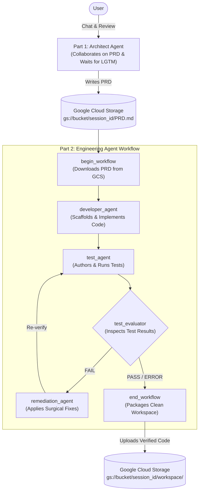
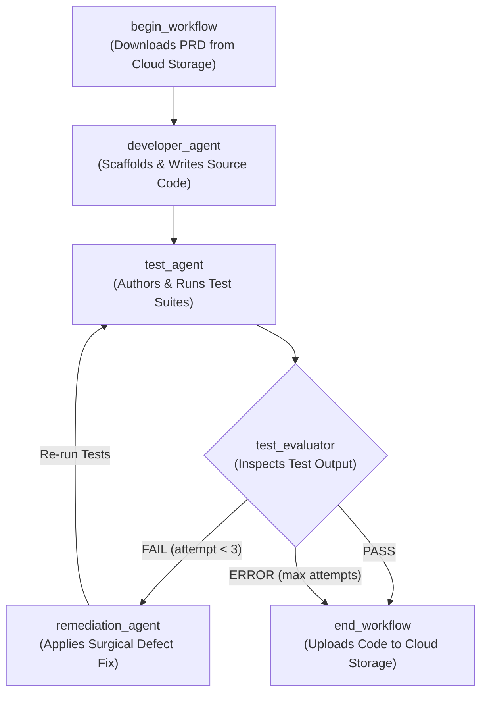

# Software Factory Codelab: Multi-Agent Software Development with ADK

Welcome to the **Software Factory** Codelab! In this hands-on workshop, you will build an autonomous, multi-agent software engineering factory using Google's **Agent Development Kit (ADK)** and **Antigravity**.

---

## Architecture Overview

The software factory consists of two decoupled systems that collaborate to design, implement, test, and remediate software:



### Lab Structure
* **`part-01-architect/`**: Build the interactive Architect Agent with tool integration and lifecycle callbacks.
* **`part-02-engineering/`**: Build the autonomous Engineering Workflow with agent sandboxing and cyclical evaluation.
* **`part-03-complete-solution/`**: Complete, working reference implementation.

---

## Prerequisites & Environment Setup

1. **Google Cloud Authentication**:
   Verify your application default credentials are active:
   ```bash
   gcloud auth application-default print-access-token
   ```

2. **Create a Cloud Storage Bucket**:
   The Software Factory uses Google Cloud Storage to persist PRDs and final code artifacts. You must create a dedicated storage bucket:
   ```bash
   # Choose a globally unique bucket name (e.g., <your-project-id>-factory)
   export FACTORY_BUCKET="<your-unique-bucket-name>"
   
   gcloud storage buckets create "gs://${FACTORY_BUCKET}" \
     --project="$(gcloud config get-value project)" \
     --location="US"
   ```
   *(Note: Remember your bucket name—you will set this in `FACTORY_BUCKET` in your `.env` files).*

3. **Configure Environment Variables**:
   Copy `.env.example` to `.env` inside the respective agent packages:
   ```bash
   # For Part 1 (inside part-01-architect):
   cp architect_agent/.env.example architect_agent/.env

   # For Part 2 (inside part-02-engineering):
   cp engineering_agent/.env.example engineering_agent/.env
   ```
   Fill in your Google Cloud configuration:
   * `GOOGLE_CLOUD_PROJECT`: Your Google Cloud Project ID (e.g., `my-project-id`).
   * `FACTORY_BUCKET`: The GCS bucket you created above (e.g., `my-factory-bucket`).
   * `GOOGLE_CLOUD_LOCATION`: Region/location (defaults to `global`).
   * `GOOGLE_GENAI_USE_ENTERPRISE=1`: Enables Vertex AI backend.

---

## Part 1: The Architect Agent

### Goal
Build an interactive Software Architect agent that collaborates with the user on product specifications and writes the finalized Product Requirements Document (PRD) to Google Cloud Storage once approved.

### Key Concepts
* **ADK `Agent`**: The core conversational agent abstraction.
* **Tool Integration (`GCSToolset`)**: Providing external tool capabilities to the agent.
* **Principle of Least Privilege**: Restricting tool access to only the necessary operations (`create_object`).
* **Session Lifecycle Callbacks (`before_agent_callback`)**: Injecting runtime session state before each agent invocation.
* **Human-in-the-Loop Gating**: Using prompt-driven approval barriers ("LGTM") before allowing stateful side effects.

---

### Step 1: Inspect Pre-Configured Files

Navigate into `part-01-architect`:
```bash
cd part-01-architect
```

Review the supporting modules in `architect_agent/`:
1. **`architect_agent/config.py`**: Loads environment variables including `FACTORY_BUCKET` and `MODEL_NAME`.
2. **`architect_agent/prompts.py`**: Defines `architect_agent_instructions`. Notice the two distinct phases:
   * **Phase 1 (Collaborate & Draft)**: The agent drafts the PRD and explicitly asks the user for review. It is strictly constrained from calling any tools.
   * **Phase 2 (Persistence Gate)**: Only upon explicit user approval (such as `"LGTM"` or `"looks good to me"`), the agent calls the GCS tool to write `PRD.md` to `{session_id}/PRD.md`.
3. **`architect_agent/callbacks.py`**: Defines `inject_session_id(callback_context)`. This callback reads `session.id` from the context and adds it to `callback_context.state["session_id"]`, making it available for dynamic prompt templating (`{session_id}`).

---

### Step 2: Configure the GCS Toolset (TODO 1)

Open `architect_agent/tools.py`.

The architect agent needs to persist files to Cloud Storage, but to maintain safety, it should **not** have delete or list permissions.

Complete **TODO 1** by instantiating `GCSToolset`:
* Use `tool_filter=["create_object"]` to only expose the object creation tool.
* Configure `gcs_tool_settings` with `Capabilities.READ_WRITE`.

```python
# architect_agent/tools.py
from google.adk.integrations.gcs import GCSToolset
from google.adk.integrations.gcs.settings import (
    Capabilities,
    GCSToolSettings,
)

# TODO 1: Configure the GCS Toolset
gcs_tools = GCSToolset(
    tool_filter=["create_object"],
    gcs_tool_settings=GCSToolSettings(
        capabilities=[Capabilities.READ_WRITE],
    ),
)
```

---

### Step 3: Assemble the Root Agent (TODO 2)

Open `architect_agent/agent.py`.

Wire together the components into an ADK `Agent` instance:
* `name`: `"architect_agent"`
* `model`: `MODEL_NAME`
* `description`: A summary of the agent's role.
* `instruction`: `architect_agent_instructions`
* `before_agent_callback`: `inject_session_id`
* `tools`: `[gcs_tools]`

```python
# architect_agent/agent.py
from google.adk.agents import Agent

from architect_agent.callbacks import inject_session_id
from architect_agent.config import MODEL_NAME
from architect_agent.prompts import architect_agent_instructions
from architect_agent.tools import gcs_tools

# TODO 2: Define root_agent
root_agent = Agent(
    name="architect_agent",
    model=MODEL_NAME,
    description=(
        "Software architect agent that collaborates on PRDs and persists "
        "them to Cloud Storage upon approval."
    ),
    instruction=architect_agent_instructions,
    before_agent_callback=inject_session_id,
    tools=[gcs_tools],
)
```

---

### Step 4: Run and Test the Architect Agent

From within `part-01-architect`, launch your agent using the ADK CLI:

```bash
adk run architect_agent
```

#### Example Interactive Walkthrough

1. **Start the conversation with an application idea**:
   ```text
   User: Let's design a Python CLI tool called 'taskcli' that manages a simple todo list in a JSON file.
   ```

2. **Collaborate and iterate**:
   The agent will structure a complete Product Requirements Document (PRD) with:
   * Overview & Goals
   * User Stories / Use Cases
   * CLI Interfaces & Arguments
   * Non-Functional Requirements & Exit Codes
   * Architecture & Implementation Plan

3. **Notice the Approval Gate**:
   At the end of its response, the agent will prompt you:
   > *"Please review the PRD above. If you approve, reply with 'LGTM' to write it to Cloud Storage, or provide your requested changes."*

4. **Approve the PRD**:
   ```text
   User: LGTM
   ```

5. **Observe Tool Execution**:
   The agent executes the `create_object` tool and responds with the storage location:
   ```text
   Agent: PRD successfully written to Cloud Storage at:
          gs://<your-bucket>/<session-id>/PRD.md
   ```

6. **Verify the GCS Output (Optional)**:
   In another terminal, check that the file was written to your bucket:
   ```bash
   gcloud storage ls gs://$FACTORY_BUCKET/**/PRD.md
   ```

---

### Checkpoint Complete!
You now have a functioning, human-gated Architect Agent that produces the input required by the **Engineering Factory** in Part 2.


---

## Part 2: The Engineering Factory (Multi-Agent Cyclic Workflow)

### Goal
Build an autonomous engineering pipeline that:
1. Downloads the PRD generated in Part 1 from Cloud Storage into an isolated workspace.
2. Directs a **Developer Agent** to implement the codebase based on the PRD.
3. Directs a **Test Agent** to author and run test suites against the implementation.
4. Evaluates test results with a **Test Evaluator** node.
5. If tests fail, directs a **Remediation Agent** to diagnose failure traces and apply surgical fixes, looping back to the Test Agent for re-verification.
6. Once tests pass (or hit iteration limits), packages and uploads the verified codebase to Cloud Storage.



---

### Key Concepts

* **Role Specialization & Separation of Concerns**:
  * The Developer Agent writes code but is prohibited from running test commands.
  * The Test Agent independently writes acceptance tests from the PRD specifications, avoiding self-grading bias.
* **Least-Privilege Security Policies (`LocalAgentConfig` & `policy`)**:
  * Default deny: `policy.deny_all()`.
  * The Developer Agent only receives file tools (`view_file`, `create_file`, `edit_file`, etc.).
  * Only verification agents (`test_agent`, `remediation_agent`) receive `policy.allow("run_command")`.
* **Cyclic Orchestration Graphs (`Workflow`)**:
  * Constructing state-machine graphs with ADK edge tuples.
  * Conditional branching using router dictionaries (`{"PASS": ..., "FAIL": ..., "ERROR": ...}`).
  * Self-healing feedback loops (`(remediation_agent, test_agent)`).
* **Defensive Termination Caps**:
  * Safeguards in `nodes.py` (e.g., maximum 3 remediation iterations) prevent runaway loops and runaway token usage.

---

### Step 1: Inspect Pre-Configured Files

Navigate into `part-02-engineering`:
```bash
cd ../part-02-engineering
```

Review the supporting modules in `engineering_agent/`:
1. **`engineering_agent/prompts.py`**:
   * `developer_agent_instructions`: Guides application implementation. Mandates that the developer must **not** write tests.
   * `test_agent_instructions`: Guides test suite creation (5–10 acceptance tests) and strictly non-interactive execution (`CI=true`). Requires ending output with `PASS` or `FAIL`.
   * `remediation_agent_instructions`: Guides minimal defect remediation by inspecting `docs/TestResults.md`.
2. **`engineering_agent/nodes.py`**:
   * `begin_workflow`: Parses the GCS URL, creates a unique workspace in `/tmp`, downloads the PRD, and assigns workspace directories to the agents.
   * `test_evaluator`: Extracts the test verdict (`PASS`/`FAIL`), increments an iteration counter, and routes to `PASS`, `FAIL`, or `ERROR` (if $\ge 3$ attempts).
   * `end_workflow`: Parses `.gitignore` to skip unwanted artifacts (`.git`, `node_modules`, `.venv`, caches), and uploads the finished workspace to Cloud Storage.
3. **`engineering_agent/utils.py`**: Lifecycle console hooks (with visual status logging) and gitignore pattern matching.

> [!NOTE] Cloud Container Portability & Ephemeral Storage (`/tmp`)
> In `engineering_agent/config.py`, notice that `WORKSPACE_HOME` defaults to `/tmp`. In cloud container environments (such as Google Cloud Run or Kubernetes), the container's root filesystem is often read-only, but `/tmp` is guaranteed to be present as a writable ephemeral mount (often a `tmpfs` volume). While space is bounded, using `/tmp` ensures that the agent remains stateless, avoids cluttering persistent host paths, and behaves identically whether run locally on a developer laptop or inside a production cloud container.

---

### Step 2: Configure Agent Security Policies (TODO 1 & TODO 2)

Open `engineering_agent/agents.py`.

Review the reference implementation of `developer_agent` at the top of the file:
```python
developer_agent_config = LocalAgentConfig(
    model=MODEL_NAME,
    system_instructions=developer_agent_instructions,
    policies=[
        policy.deny_all(),
        policy.allow("view_file"),
        policy.allow("create_file"),
        policy.allow("edit_file"),
        policy.allow("list_directory"),
        policy.allow("find_file"),
        policy.allow("search_directory"),
    ],
    hooks=create_agent_hooks("developer_agent", "💻", "implementation"),
)
```

Now complete the configurations for the test and remediation agents:

#### TODO 1: Configure the Test Agent
The test agent needs file tools **plus** command execution permission (`run_command`) to run test suites:

```python
# engineering_agent/agents.py

# TODO 1: Configure test_agent
test_agent_config = LocalAgentConfig(
    model=MODEL_NAME,
    system_instructions=test_agent_instructions,
    policies=[
        policy.deny_all(),
        policy.allow("view_file"),
        policy.allow("create_file"),
        policy.allow("edit_file"),
        policy.allow("list_directory"),
        policy.allow("find_file"),
        policy.allow("search_directory"),
        policy.allow("run_command"),
    ],
    hooks=create_agent_hooks("test_agent", "🔍", "verification"),
)

test_agent = AntigravityAgent(
    name="test_agent",
    description="Software test agent",
    mode="single_turn",
    config=test_agent_config,
)
```

#### TODO 2: Configure the Remediation Agent
The remediation agent also needs file access and `run_command` (to verify its surgical patch):

```python
# engineering_agent/agents.py

# TODO 2: Configure remediation_agent
remediation_agent_config = LocalAgentConfig(
    model=MODEL_NAME,
    system_instructions=remediation_agent_instructions,
    policies=[
        policy.deny_all(),
        policy.allow("view_file"),
        policy.allow("create_file"),
        policy.allow("edit_file"),
        policy.allow("list_directory"),
        policy.allow("find_file"),
        policy.allow("search_directory"),
        policy.allow("run_command"),
    ],
    hooks=create_agent_hooks("remediation_agent", "🔧", "defect remediation"),
)

remediation_agent = AntigravityAgent(
    name="remediation_agent",
    description="Software remediation agent",
    mode="single_turn",
    config=remediation_agent_config,
)
```

---

### Step 3: Assemble the Cyclic Workflow Graph (TODO 3)

Open `engineering_agent/agent.py`.

Wire the workflow together using ADK's `Workflow` class. The workflow contains three distinct edge definitions:
1. **Initial Pipeline**: `START` $\rightarrow$ `begin_workflow` $\rightarrow$ `developer_agent` $\rightarrow$ `test_agent`.
2. **Conditional Branch**: `test_agent` $\rightarrow$ `test_evaluator` $\rightarrow$ dictionary routing (`PASS`/`ERROR` to `end_workflow`, `FAIL` to `remediation_agent`).
3. **Remediation Loop**: `remediation_agent` $\rightarrow$ `test_agent` (re-runs the test suite after every fix).

```python
# engineering_agent/agent.py
from google.adk import Workflow

from engineering_agent.agents import (
    developer_agent,
    remediation_agent,
    test_agent,
)
from engineering_agent.nodes import (
    begin_workflow,
    end_workflow,
    test_evaluator,
)

# TODO 3: Define the engineering workflow
root_agent = Workflow(
    name="engineering_workflow",
    edges=[
        (
            "START",
            begin_workflow,
            developer_agent,
            test_agent,
        ),
        (
            test_agent,
            test_evaluator,
            {
                "ERROR": end_workflow,
                "PASS": end_workflow,
                "FAIL": remediation_agent,
            },
        ),
        (
            remediation_agent,
            test_agent,
        ),
    ],
)
```

---

### Step 4: Run the Complete Software Factory Pipeline!

Now run the engineering workflow by passing the Cloud Storage URI of the PRD created in Part 1:

```bash
adk run engineering_agent --input="gs://$FACTORY_BUCKET/<session_id>/PRD.md"
```

> **Note**: Replace `<session_id>` with the actual session ID from your Part 1 run. You can find it with:
> ```bash
> gcloud storage ls "gs://$FACTORY_BUCKET/**/PRD.md"
> ```

#### Observe the Execution Flow in Console:

```text
🚀 [begin_workflow] Initializing workflow with input: gs://.../PRD.md
🏁 [begin_workflow] Initialization complete. Workspace ready at: /tmp/...

💻 [developer_agent] Starting implementation...
   ⚙️ [developer_agent] Executed: view_file (docs/PRD.md)
   ⚙️ [developer_agent] Executed: create_file (taskcli.py)
   ⚙️ [developer_agent] Executed: create_file (.gitignore)
✅ [developer_agent] Completed implementation.

🔍 [test_agent] Starting verification...
   ⚙️ [test_agent] Executed: view_file (docs/PRD.md)
   ⚙️ [test_agent] Executed: create_file (tests/test_taskcli.py)
   ⚙️ [test_agent] Executed: run_command (CI=true python3 -m unittest discover)
   ⚙️ [test_agent] Executed: create_file (docs/TestResults.md)
✅ [test_agent] Completed verification.

⚖️ [test_evaluator] Evaluating test results (attempt 1)...
   (If FAIL: routes to remediation_agent -> test_agent loop)
   (If PASS: routes to end_workflow)

📦 [end_workflow] Starting final workflow packaging and GCS upload...
🏁 [end_workflow] Upload complete! Successfully uploaded files to gs://...
```

Verify that the final codebase has been stored in Cloud Storage:
```bash
gcloud storage ls "gs://$FACTORY_BUCKET/**"
```

---

## Conclusion & Key Takeaways

Congratulations! You have built a complete, production-grade **Autonomous Software Factory**:

1. **Human-in-the-Loop Architecture**: High-level alignment and requirements definition with an interactive Architect Agent backed by explicit user sign-off.
2. **Zero-Trust Sandboxing**: Fine-grained capability policies ensuring agents cannot perform unauthorized actions or grade their own work.
3. **Autonomous Self-Healing Loops**: Graph-based orchestration using test failures as autonomous feedback to repair code without human intervention.
